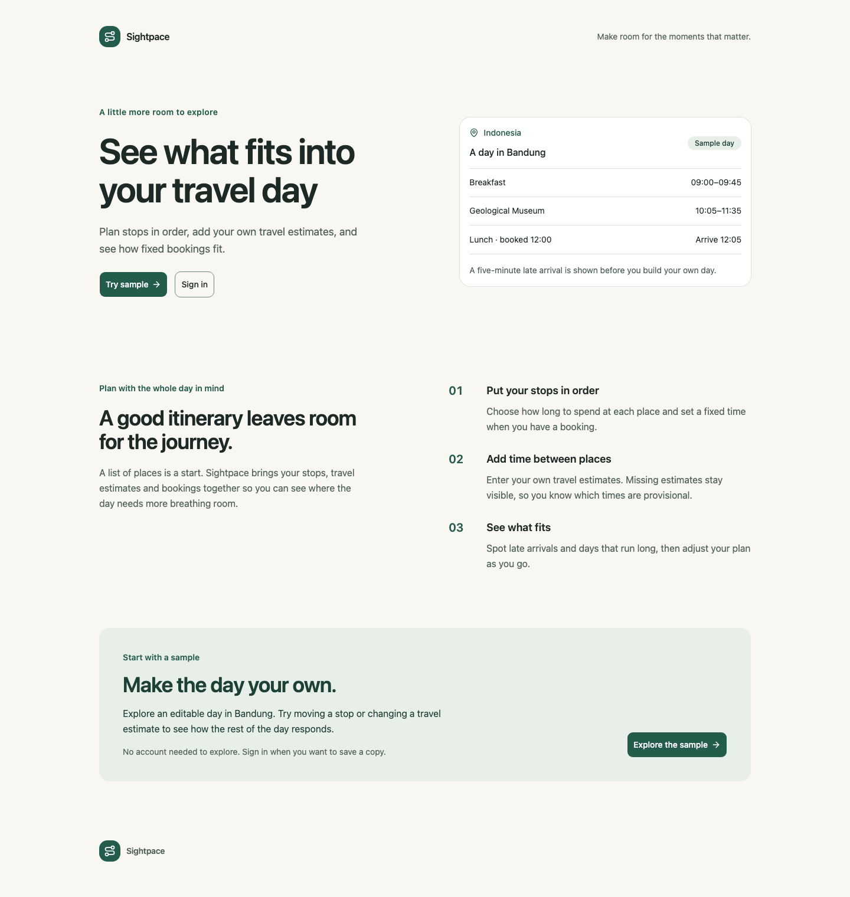
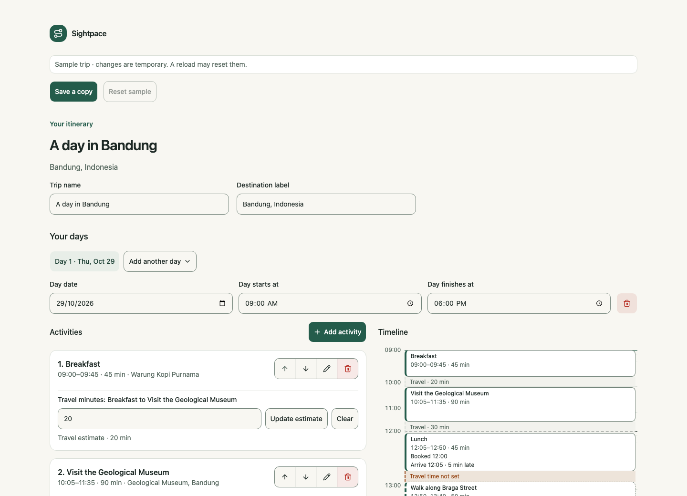

# Sightpace

> Make room for the moments that matter. Plan a day that feels like a holiday.

Sightpace helps independent travelers see whether sightseeing stops fit around travel estimates and fixed bookings. Arrange a day, enter your own travel times, and see projected arrival times, late bookings, missing estimates, and overruns as your plan changes.

## What you can do

- Edit a synthetic Bandung itinerary and see its schedule recalculate immediately.
- Add, edit, reorder, and remove days and activities; optionally set fixed booking times.
- Enter manual travel estimates between neighboring stops. Unknown estimates remain visible instead of being treated as confirmed travel time.
- Inspect projected arrivals, waiting, late bookings, provisional times, and day overruns.
- Sign in with Google to create and manage private trips that persist in PostgreSQL. Saves are revision-checked, and pending edits can be recovered after a reload.

Travel times are entered by the traveler. Sightpace does not provide live routing, venue hours, booking integrations, or guaranteed feasibility.

## Screenshots

### Landing page



### Editable sample itinerary



The public sample itinerary is synthetic and available at `/demo`. Its edits are temporary; sign in to save a personal copy.

## Technology

| Area           | Stack                                                                                           |
| -------------- | ----------------------------------------------------------------------------------------------- |
| Application    | Next.js App Router, React, strict TypeScript                                                    |
| UI             | Tailwind CSS, shadcn/ui source components with Base UI primitives, Lucide icons                 |
| Data           | PostgreSQL, Prisma ORM 7 with the PostgreSQL driver adapter                                     |
| Authentication | Better Auth with Google-only sign-in                                                            |
| Verification   | Biome, TypeScript, Vitest, Testing Library, Playwright, disposable PostgreSQL integration tests |
| Hosting        | Production site with private staging and PostgreSQL-backed trip storage                         |

## Run locally

### Requirements

- Node.js `26.x`
- pnpm `12.16.1` (pinned in `package.json`)
- PostgreSQL for private trips and authentication
- A Google OAuth Web client for local sign-in

### Setup

```bash
git clone https://github.com/kangcommit/Sightpace.git
cd Sightpace
pnpm install --frozen-lockfile
cp .env.example .env
```

Edit `.env` locally with separate pooled/runtime (`DATABASE_URL`) and direct/migration (`DIRECT_URL`) URLs for a development-only PostgreSQL database, a random `BETTER_AUTH_SECRET` of at least 32 characters, and your Google OAuth client credentials. The two database URLs must target the same development database; do not reuse staging or production credentials locally. Do not commit `.env`. Register this local callback in the Google OAuth client:

```text
http://localhost:3000/api/auth/callback/google
```

Then, after confirming both URLs point to your local development database (not staging or production):

```bash
pnpm db:generate
pnpm db:validate
pnpm db:deploy
pnpm dev
```

Open [http://localhost:3000](http://localhost:3000). You can explore `/demo` without configuring Google sign-in; authentication and private trips need the database and OAuth settings. Before applying migrations to a shared or persistent database, review the migration SQL and confirm the target carefully.

### Environment variables

| Variable               | Purpose                                                                                                |
| ---------------------- | ------------------------------------------------------------------------------------------------------ |
| `DATABASE_URL`         | Pooled PostgreSQL connection used by the application at runtime.                                       |
| `DIRECT_URL`           | Direct, non-pooled connection to the same environment's database, used by Prisma CLI migrations.       |
| `BETTER_AUTH_SECRET`   | Server-only Better Auth signing/encryption secret; at least 32 characters.                             |
| `BETTER_AUTH_URL`      | Exact canonical auth origin; HTTP loopback is allowed in development, HTTPS is required in production. |
| `GOOGLE_CLIENT_ID`     | Server-side Google OAuth client identifier.                                                            |
| `GOOGLE_CLIENT_SECRET` | Server-side Google OAuth credential.                                                                   |
| `NEXT_PUBLIC_SITE_URL` | Public canonical URL used for site metadata and canonical links.                                       |

See [.env.example](.env.example) for the variable names. Never put secrets in `NEXT_PUBLIC_*`, screenshots, source control, or issue reports.

Use a unique database URL pair and auth credentials for each local, staging, and production environment. Deploy previews must not receive production credentials.

## Development commands

| Command                 | Purpose                                                                                        |
| ----------------------- | ---------------------------------------------------------------------------------------------- |
| `pnpm dev`              | Start the Next.js development server.                                                          |
| `pnpm check`            | Run the repository Biome check.                                                                |
| `pnpm typecheck`        | Run the TypeScript project check.                                                              |
| `pnpm test`             | Run unit and component tests.                                                                  |
| `pnpm test:integration` | Run integration tests with the configured disposable PostgreSQL fixture.                       |
| `pnpm test:e2e`         | Run Playwright browser tests.                                                                  |
| `pnpm verify`           | Run Biome, typecheck, unit tests, production build, and Knip.                                  |
| `pnpm build`            | Create the production Next.js build.                                                           |
| `pnpm db:generate`      | Generate the Prisma client.                                                                    |
| `pnpm db:validate`      | Validate the Prisma schema.                                                                    |
| `pnpm db:deploy`        | Apply committed migrations to the database in `DIRECT_URL`; confirm the target before running. |

Integration tests require Docker for their isolated PostgreSQL fixture. Do not point test commands at a development or production database.

## Repository layout

```text
src/
├── app/                    # Next.js routes, route handlers and layouts
├── components/             # Shared app and shadcn UI components
├── features/trips/
│   ├── editor/              # Planner editor, timeline, autosave and recovery
│   ├── forms/               # Trip creation and deletion controls
│   ├── sample/              # Public Bandung sample planner
│   ├── server/              # Authenticated actions and persistence queries
│   └── shared/              # Trip feature rules
└── lib/                     # Authentication, Prisma, scheduling and shared utilities
prisma/                      # Schema and committed database migrations
tests/
├── e2e/                     # Playwright browser tests
├── integration/             # PostgreSQL and browser journey tests
└── unit/                    # Unit and component tests
```

## Repository references

- [Environment variable names](.env.example)
- [Package scripts and pinned toolchain](package.json)
- [Prisma schema](prisma/schema.prisma)
- [Committed database migrations](prisma/migrations/)
- [Continuous integration workflow](.github/workflows/ci.yml)
